# 길갈, 여호수아 읽기 🚩

> **"24일 동안 공동체가 함께 여호수아의 길을 걷는"** 성경 통독 서비스

**포드교회 청년캠프1**이 11월 한 달 동안 여호수아 24장을 하루 한 장씩 함께 읽기 위해 만든
웹 서비스입니다. 한 장을 읽을 때마다 내 아바타가 지도 위에서 이스라엘의 여정을 한 걸음씩
따라가고, 그 장소에서 있었던 사건이 지도 위에 짧은 연출로 펼쳐집니다.

<p>
  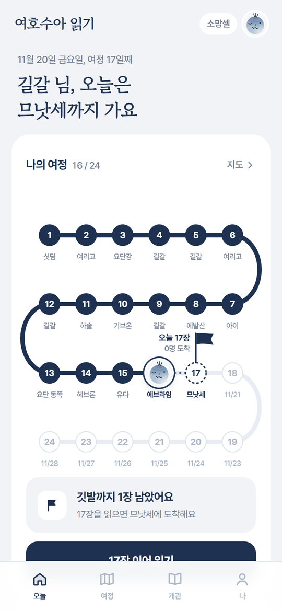
  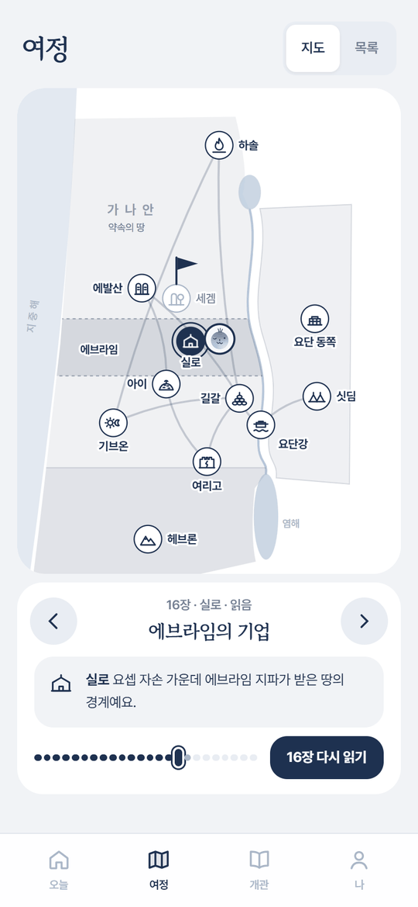
  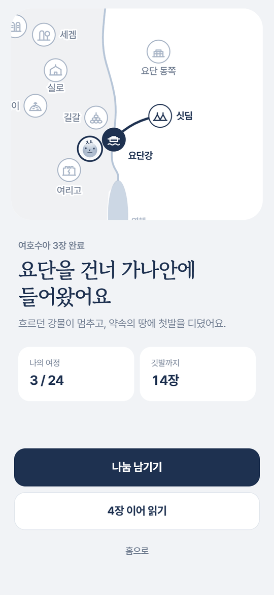
  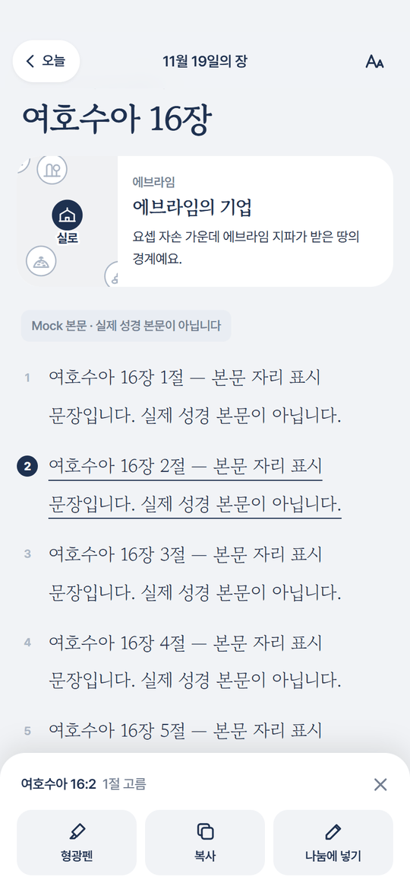
</p>

<p>
  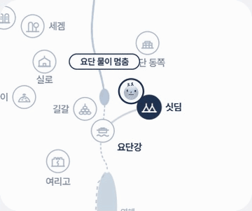
  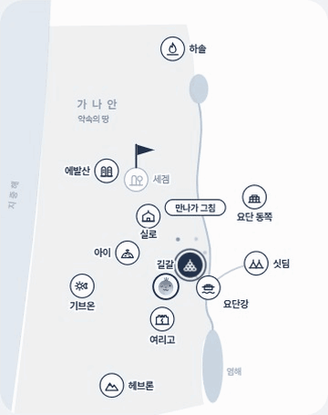
  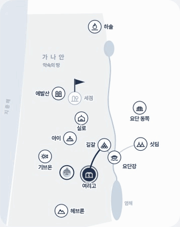
</p>

---

## 📌 개요

| 항목 | 내용 |
|---|---|
| **제작 배경** | 포드교회 청년캠프1이 여호수아서를 함께 통독하기 위해 제작 (같은 공동체의 [Selah](https://github.com/wanja727/project-selah) 다음 프로젝트) |
| **서비스 기간** | 2026.11.02 ~ 2026.11.28 (주일 제외 24일, 하루 한 장) |
| **개발 기간** | 2026.10.17 ~ 오픈(11.02), 이후 운영 중 지속 개선 (총 156 커밋) |
| **사용 인원** | 가입 **140명** · 읽기 참여 **128명** (2026.11.07 기준) |
| **역할** | 기획 · 디자인 · 개발 · 운영 1인 |
| **배포** | Vercel (Seoul `icn1` 리전) + Supabase PostgreSQL (서울) |

---

## 🛠️ 기술 스택

**Frontend / Framework**
- Next.js 16 (App Router, React Server Components, Server Actions, `after()`)
- React 19 (`useSyncExternalStore`, `useTransition`), TypeScript strict
- Tailwind CSS v4 (`@theme` 디자인 토큰)
- **인라인 SVG + CSS 애니메이션** — 지도·연출·진행도 모두 외부 지도/애니메이션 라이브러리 없이 직접 구현

**Backend / Data**
- Drizzle ORM + PostgreSQL (Supabase) — 런타임은 `pg` + Vercel `attachDatabasePool`, 스크립트는 postgres.js
- Auth.js (NextAuth v5) — **카카오 OAuth**, DB 세션 전략
- DiceBear `marbles` + 직접 그린 부품 — 서버에서 아바타 SVG 생성

**품질**
- Vitest 172개 테스트 (날짜·공개 규칙·진행도·구절 범위·관리자 지표 등 순수 함수 중심)
- 설계 결정 기록(ADR) 38개 — `docs/architecture.md`

---

## ✨ 주요 기능

### 1. 하루 한 장, 지도 위를 걷는 여정

여호수아 24장은 싯딤 → 요단강 → 길갈 → 여리고 → … → 세겜으로 이어지는 실제 여정입니다.
한 장을 읽으면 내 아바타가 그 장의 장소로 걸어가고, 홈의 진행도에서도 한 칸씩 나아갑니다.
**장은 날짜에 맞춰 하루씩 열리고**, 지도에도 열린 장소만 드러나 "길이 그날 열리는" 경험을
만들었습니다.

<p>
  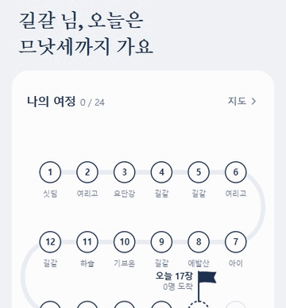
  
</p>

### 2. 장소마다 펼쳐지는 사건 연출 (24장 전부)

여정 탭에서 장을 넘기거나 읽기를 마치면, 그 장의 사건이 지도 위에 3~6초짜리 연출로 펼쳐집니다.
그림만으로는 무엇인지 모를 수 있어 **본문 속 표현으로 짧은 사건 이름표**를 함께 띄웁니다.

| 장 | 연출 |
|---|---|
| 3장 요단을 건너다 | 강물이 위에서 멈춰 쌓이고, 아래 물길이 마른 뒤 아바타가 건넌다 |
| 4장 열두 돌 | 요단 바닥의 둥근 돌 열두 개가 하나씩 떨어져 쌓인다 |
| 6장 여리고 | 행렬이 성을 일곱 바퀴 돌고, 외침이 퍼지고, 성벽 조각이 무너진다 |
| 7장 아간의 죄 | 아이에서 되밀려 내려온 뒤, 아골 골짜기에 돌무더기가 쌓인다 |
| 10장 해와 달 | 해와 달이 기브온을 중심으로 천천히 돌다 기브온 위·아얄론에 멈춘다 |
| 13~19장 땅 분배 | 지파의 땅이 장마다 한 조각씩 채워지고, 21장에서 온 땅이 함께 빛난다 |

<p>
  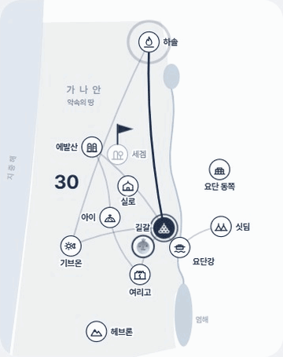
</p>

### 3. 본문 읽기 · 형광펜 · 구절을 담은 나눔

본문은 서비스 안에서 장·절로 나눠 보여 줍니다. 절을 누르면 **형광펜 · 복사 · 나눔에 넣기**
도구가 뜨고, 나눔에 넣은 구절은 `16:1-3` 같은 범위로 정리됩니다. 나눔의 구절 칩을 누르면
본문이 화면에 있을 땐 그 절로 스크롤해 반짝이고, 없으면 그 자리에서 본문을 펼쳐 보여 줍니다.
글자 크기·글꼴·굵기·줄 간격·배경(기본/종이/어둡게) 읽기 설정도 있습니다.

<p>
  
  
</p>

### 4. 나만의 아바타 · 개관 · 관리자 지표

- **아바타 꾸미기** — 머리·모자·눈·입·코·안경·얼굴색을 골라 꾸미고, 그 아바타가 지도 위를 걷습니다.
- **개관** — 목사님이 쓰신 여호수아 개관(표어·배경·네 부분·핵심 구절)을 한 화면에.
- **관리자 지표** — 참여율·읽기 추이·셀별/개인별 진행·방문 기록. 관리자 권한은 DB에서만 부여합니다.

<p>
  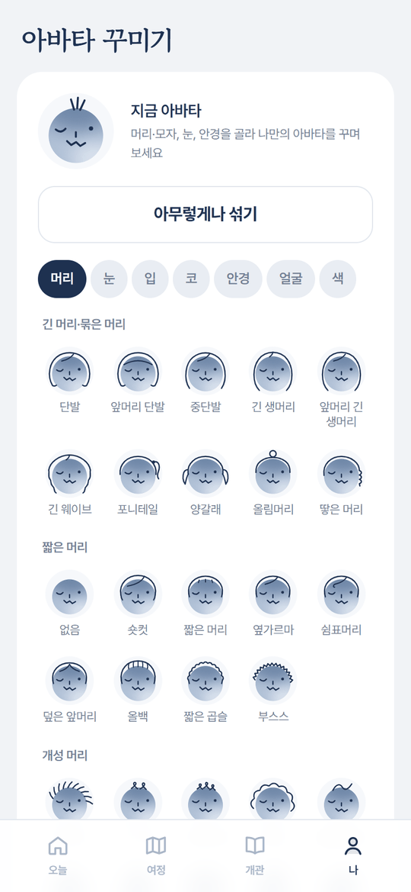
  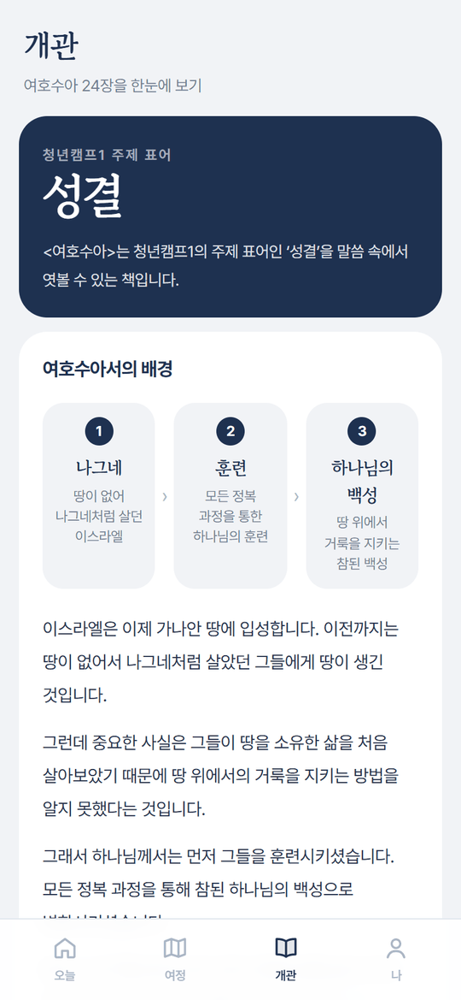
</p>

---

## 🎬 UX와 애니메이션에서 신경 쓴 점

이번 프로젝트에서 가장 공을 들인 부분입니다. 매일 들어오는 짧은 사용 시간 안에 **"오늘도 한
걸음 걸었다"** 는 감각을 주는 것이 목표였고, 연출 하나하나를 실제 기기에서 프레임 단위로
확인하며 다듬었습니다.

### 1. 성경 고증을 따르는 연출 — "그림은 보여 주되, 해석은 하지 않는다"

서비스 원칙상 본문에 대한 해석·해설은 넣지 않습니다. 그래서 연출도 **본문에 적힌 사건만**
그리고, 의미는 본문에 맡겼습니다.

- **4장 열두 돌** — 처음엔 각진 벽돌이었지만, 돌의 출처가 요단강 바닥(4:3)이라는 점을 반영해
  크기·기울기가 조금씩 다른 **둥근 강돌**로 바꿨습니다. 7장 아간의 돌무더기는 들의 **거친 돌**로
  그려 두 장면을 구분합니다.
- **10장 해와 달** — "태양아 기브온 위에 머무르라, 달아 아얄론 골짜기에서"(10:12). 해와 달이
  스르륵 나타나 기브온을 중심으로 천천히 네 분의 한 바퀴를 돌다 각자의 자리에서 멈춥니다.
  여러 바퀴 도는 버전은 가볍게 느껴져, **한 번의 느린 움직임으로 무게감**을 줬습니다.
- **9장 기브온** — 입말 이름표와 왕복 움직임이 유치하다는 피드백을 받아, 본문 표현
  ("여호와께 묻지 아니하고 조약" → "사흘 뒤 이웃임이 드러남")과 길갈·기브온을 잇는 선 하나로
  "가까운 이웃이었다"는 사실을 말없이 보여 주도록 바꿨습니다.
- **7장 아간의 죄** — 진노는 번쩍임이나 어두워지는 효과로 그리지 않고, 패배와 돌무더기라는
  사건만 보여 줍니다.
- **지리 점검** — 19장 "나머지 일곱 지파"가 실제로 일곱으로 세어지게 땅을 나누고, 22장 제단은
  본문대로 "가나안 쪽 요단 언덕 가"(22:11)에 두었습니다.

### 2. 타이밍 설계 — 길 → 아바타 → 사건 순서로

연출이 동시에 터지면 산만합니다. 모든 연출은 CSS 변수 `--fx-delay`(길이 다 그려지고 아바타가
도착한 뒤)와 요소별 `--t` 로 박자를 맞춥니다.

```css
.fx-drop, .fx-pop, .fx-travel /* … */ {
  opacity: 0;
  animation-delay: calc(var(--fx-delay) + var(--t, 0s));
  animation-fill-mode: forwards;
}
```

- 요단(3장)만 예외 — **물이 먼저 멈춰야** 아바타가 건널 수 있으므로 길 그리기와 아바타 걸음을 0.5초 늦춥니다.
- 사건 이름표는 연출과 같은 박자로 떴다가 3초쯤 머물고 사라지며, 7·9·11장처럼 두 장면으로 이어지는
  장은 같은 자리에서 이름표가 바뀝니다.
- 남는 그림(돌·제단·해와 달·나뉜 땅)은 그 장을 보는 동안 지도에 남고, 움직임(행렬·사람들)은 끝나면 사라집니다.

### 3. 겹침을 없애는 레이어 설계

작은 지도 위에 장소 아이콘·지명·아바타·깃발·연출·이름표가 모두 올라가다 보니 "무엇이 무엇을
가리는가"가 계속 문제였습니다. 하나씩 피해 다니는 대신 **규칙**으로 풀었습니다.

- 레이어를 `under`(물길·땅) / 장소 아이콘 / `over`(사건) / 깃발·아바타 / `caption`(이름표) 순으로 고정
- 오늘의 깃발은 **그 장소를 보고 있는 동안 서서히 숨김** — 선택 테두리와 장 카드가 이미 같은 말을 하고,
  깃발이 장소 바로 위라 연출과 늘 겹쳤기 때문. 연출을 장마다 깃발을 피해 옮기는 것보다 단순하고, 앞으로
  연출을 고쳐도 겹치지 않습니다.
- 아직 드러나지 않은 장소로 가는 연출(2장 정탐꾼 → 여리고, 9장 기브온)은 그 장에서만 **흐린 점선 아이콘**을 보여 줍니다.
- 지나온 길은 실제로 걸은 1~12장까지만 선으로 잇고, 땅을 나누는 후반은 "걸음"이 아니라 "채워짐"으로 표현합니다.

### 4. 가볍고 접근성 있는 애니메이션

- **훅 없는 연출 컴포넌트** — 연출은 순수 SVG + CSS라 서버·클라이언트 어디서든 같은 결과로 그려집니다.
  12장 "서른한 왕" 카운터도 JS 타이머 없이 겹쳐 둔 숫자를 CSS로 차례로 켜서 `--fx-delay` 를 그대로 따릅니다.
- **`transform` / `opacity` 위주** — 행렬은 그룹 회전, 해와 달은 궤도 회전 + 반대 회전으로 똑바로 세우기,
  돌은 `transform-box: fill-box` 로 아래 가장자리 기준 눌림.
- **`prefers-reduced-motion`** — 움직임 줄이기 설정이면 연출 전체(`.fx`)를 그리지 않습니다.

### 5. 모바일 사용성 디테일

- **안드로이드 키보드** — 크롬에서 키보드가 나눔 입력창을 가리던 문제를 `interactive-widget=resizes-content` 로 해결.
- **상단 바 깜빡임** — 펼침·접힘으로 페이지 높이가 바뀌며 생긴 스크롤에 숨김 바가 다시 나타나던 문제를
  `ResizeObserver` 로 크기 변화 직후의 스크롤을 무시해 해결.
- **구절 펼침** — 높이 전환 + 결과 캐시 + 누르는 순간(pointerdown) 미리 불러오기로 깜빡임 없이 열고 닫기.
- **하루는 새벽 4시에 바뀜** — 자정 넘어 읽는 사람이 많아 "오늘"을 KST 04:00 기준으로 계산(ADR-033).

---

## 🧭 구현 과정에서 신경 쓴 점

### 1. 운영 중인 서비스를 안전하게 고치기 — 데이터 분리와 테스트 계정 CLI

개발·테스트·운영이 **하나의 Supabase 프로젝트**를 씁니다. 대신 데이터가 섞이지 않게:

- 읽기 기록·나눔은 **캠페인 slug**(`joshua-2026` / `joshua-2026-test`)로 분리하고, 로컬·Preview 는 테스트 slug 만 씁니다.
- `pnpm test-user` CLI — 카카오 로그인 없이 `is_test` 계정·세션 쿠키·읽기 기록·예시 나눔을 만들어
  **원하는 날짜·진행 상태의 화면을 바로** 띄웁니다. `GILGAL_DEV_NOW` 로 서비스 날짜를 바꿔 출발 전 / 정식 / 주일 /
  밀린 날 / 종료 후 시나리오를 검증합니다. (이 README 의 화면도 이 방식으로 찍었습니다.)
- 마이그레이션은 `drizzle-kit generate` → SQL 리뷰 → `migrate` 만 허용(`push` 금지).

### 2. 이전 서비스(Selah)와의 연결 — 최소 이관

같은 공동체가 쓰던 Selah 와 **카카오 OAuth 앱만 공유**하고 DB 는 완전히 분리했습니다. 기존 회원은 카카오
회원번호로 연결하고, 실명·셀 정보만 오픈 전 1회 CSV 로 이관했습니다. 카카오 회원번호는 클라이언트로 보내지
않고, 이관 CSV 는 적재 후 삭제합니다.

### 3. 운영 중 장애 대응

- **홈 멈춤** — 서버리스 환경에서 DB 연결이 쌓이며 홈이 멈추던 문제를 `pg` + Vercel `attachDatabasePool` 로
  드라이버를 바꿔 해결(ADR-032). 홈 질의도 5개 → 2개로 줄이고 병렬화했습니다.
- **방문 기록** — 응답을 늦추지 않도록 `after()` 로 응답 후에 기록합니다.

### 4. 설계 문서와 결정 기록

요구사항(`docs/requirements.md`) · 아키텍처(`docs/architecture.md`) · 구현 계획(`docs/implementation-plan.md`)을
먼저 쓰고, 중요한 결정은 **결정 / 배경 / 대안 / 결과** 형식의 ADR 로 38개를 남겼습니다. 결정을 뒤집을 때도 지우지
않고 "대체됨"으로 남기고, 운영 중 피드백으로 바뀐 내용은 `[변경]` 으로 날짜와 이유를 기록했습니다.

---

## 🗂️ 프로젝트 구조

```
app/
  (tabs)/            오늘(홈) · 여정 · 개관 · 나 · 관리자(/me/admin)
  day/[day]/         장 본문 읽기 · 절 도구 · 나눔 · 도착 화면
  finale/            24장 완주 화면
  onboarding/        카카오 ID → 실명 매칭 → 셀 선택
  api/avatar/[key]/  아바타 SVG 생성
components/
  map/               JourneyMap(지도) · MapEffects(장별 사건 연출) · SiteGlyph(장소 아이콘)
  reading/           본문 · 절 도구 · 도착 화면 · 상단 바
  share/             나눔 입력창 · 구절 칩 · 구절 펼침
lib/
  journey/           24일 여정 데이터(장소·좌표·연출·문구) · 공개 규칙 · 지도 상태
  bible/             BibleTextProvider(mock/db) · 본문 파서
  time/              KST · 새벽 4시 하루 경계 · GILGAL_DEV_NOW
  admin/             관리자 지표(순수 함수 + 테스트)
  db/ · data/        Drizzle 스키마 · 서버 전용 데이터 접근
scripts/             Selah 명단 이관 · 본문 적재 · test-user CLI
docs/                요구사항 · 아키텍처(ADR) · 구현 계획
```

---

## 📅 개발 타임라인 (커밋 기반)

- **10.17–19** — 설계 문서(요구사항·아키텍처·구현 계획), Phase 1: DB·카카오 로그인·명단 이관·온보딩·읽기·지도·홈
- **10.24–26** — 디자인 시안 v5(남색), 나눔, 개관 탭, 도착 화면(아바타가 길을 따라 걷기), 읽기 설정
- **10.29–30** — 아바타 꾸미기, 구절을 담은 나눔, 홈 진행도 연출(걷는 아바타·펄럭이는 깃발·카운트업)
- **11.01** — 길은 그날 열린다, 셀 없이 개인 참여, 운영 DB 드라이버 교체, 새벽 4시 하루 경계
- **11.02** — **정식 오픈**
- **11.03** — 절 도구·형광펜, 구절 펼침, 안드로이드 키보드 대응, 관리자 지표·방문 기록
- **11.04–06** — **장소 사건 연출 24장**, 땅이 쌓이는 후반 지도, 고증·겹침 점검, 깃발 숨김, 9·10장 연출 다듬기

---

## 🚀 로컬 실행

```bash
pnpm install
pnpm dev              # http://localhost:3000

pnpm db:generate      # 스키마 변경 → SQL 리뷰
pnpm db:migrate       # 마이그레이션 적용 (push 금지)

pnpm test-user create --done 1-5   # 카카오 없이 화면 확인용 테스트 계정·세션 쿠키
pnpm typecheck && pnpm lint && pnpm test
```

`.env.example` 의 키를 `.env.local` 에 채웁니다 — 카카오 OAuth(`AUTH_KAKAO_ID`·`AUTH_KAKAO_SECRET`), `AUTH_SECRET`,
Postgres 연결(`DATABASE_URL`·`DIRECT_URL`), `BIBLE_PROVIDER`(`mock`/`db`), 캠페인 slug(`GILGAL_CAMPAIGN`).

---

<p align="center"><em>길갈 — 요단을 건넌 뒤 열두 돌을 세워 기억한 곳처럼, 함께 걸은 24일을 기억하며.</em></p>
